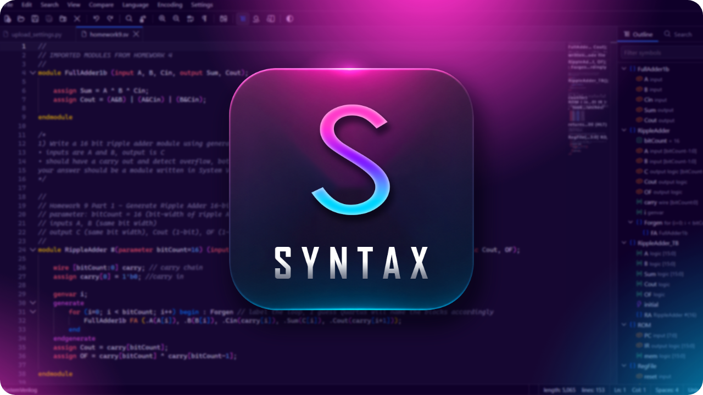

<p align="center"></p>

# Syntax

A fast, private, browser-based code editor with the everyday features of a desktop
text editor. It runs entirely in your browser (files are never uploaded) and is hosted on GitHub Pages.

## Features

- **Drag & drop** files, or whole folders, anywhere on the window; each opens as a tab. You can also use Open (Ctrl+O) or New (Alt+N).
- **Syntax highlighting** for 60+ languages, including **Verilog**, **SystemVerilog**,
  **VHDL** and **Tcl / XDC / SDC**, plus C/C++, C#, Java, Python, JS/TS, Go, Rust, PHP, Ruby, Kotlin, Swift,
  Scala, SQL, shell, PowerShell, HTML/CSS, JSON, XML, YAML, Markdown and more. The language is detected from the
  extension and can be changed from the status bar or the Language menu.
- **Compare** two files side by side (or inline) with diff highlighting (Ctrl+Alt+C). Both sides stay editable.
- **Split view**: two editors side by side, each with its own tabs, as in Notepad++. Right-click a tab for
  *Move to Other View* or *Clone to Other View*. A clone shows the same file in both views, so edits appear in both.
  You can also drag tabs between the views.
- **Markdown preview** (Ctrl+Shift+V, View menu or toolbar): a live rendered view beside any Markdown tab that
  updates as you type and follows the editor's scroll position. Code blocks are syntax highlighted and the
  divider can be dragged. Raw HTML in the file is sanitized; remote images and links work as on the web.
- **HDL tools** for Verilog, SystemVerilog and VHDL:
  - **Outline** panel (Alt+O): modules, entities, ports, parameters, signals, processes, instances and
    generate blocks. Click an item to jump to it; the item under the cursor is highlighted.
  - **Go to Definition** (F12 / Ctrl+Click, Alt+F12 to peek): jumps to a module or entity in any open tab,
    and to signal and port declarations. **Go to Symbol** (Ctrl+Shift+O).
  - **Copy as Instance** (right-click or the Edit menu): copies a ready-to-paste instantiation with named port and
    parameter connections. **Insert Instance of…** picks any module or entity in the open tabs.
  - **Align Statements** (Ctrl+Alt+A): lines up `=`, `<=`, `:=`, `=>`, `.port (sig)` and declaration columns.
    To realign automatically when you press Enter, turn on *Settings → Auto-Align on Enter*.
- **Find in all tabs** (Ctrl+Shift+F): search and replace across every open file, with regex, match case and
  whole word. Results are grouped by file. Each file's replacement is a single undo step.
- **Bookmarks**: Ctrl+F2 (or click the margin) toggles a bookmark; F2 / Shift+F2 jump between them. The Search → Bookmark menu
  copies, cuts or removes the bookmarked or unbookmarked lines.
- **Editing**: per-tab undo/redo, find & replace with regex, go to line, multi-cursor and column
  selection, line operations (duplicate, move, delete, sort, join, trim trailing whitespace), case conversion,
  comment toggling, folding, word wrap, show whitespace, zoom, and a command palette (F1).
- **Indentation per file**: tabs or spaces and the indent size are detected on open and shown in the status bar.
  Click there to change or convert them. The defaults for new files are in Settings.
- **Format Document** (Shift+Alt+F) for JSON, HTML, CSS/SCSS/LESS and JavaScript/TypeScript.
- **Saving**: Ctrl+S saves in place when the browser supports the File System Access API (Chrome / Edge). Otherwise it
  downloads the file. Save As, Save All, and **Download All as ZIP** are also available.
- **Encodings & line endings**: UTF-8, UTF-8 BOM and UTF-16 LE/BE are detected on open and kept on save. You can convert CRLF ↔ LF.
- **Themes**: Light / Dark / Match System, and 7 color schemes (Default, Classic / Obsidian, Solarized, GitHub, One,
  Gruvbox, Vivid), each with a light and a dark variant.
- **Safety net**: unsaved tabs are marked. Closing a modified tab asks to save, and leaving the page with
  unsaved changes prompts first. Open tabs, including unsaved edits, are kept in the browser's IndexedDB and
  restored after a reload or crash, along with bookmarks and the split layout. (Undo history is not kept across reloads.)
- **Recent files** (Chrome / Edge): *File → Recent Files* reopens recently closed files from disk.
- **Installable app**: Chrome and Edge can install Syntax (*File → Install as App…* or the address bar). It then
  works offline, and the OS *Open with* menu can send source files straight to it.
- **File icons on Windows**: browsers register an installed web app's file types without an icon, so files
  that open with Syntax show a blank page. It doesn't affect how they open. *Settings → Fix-icons script* downloads
  a PowerShell script (right-click → *Run with PowerShell*) that gives them the Syntax icon. It changes only your
  own user settings (HKCU), needs no admin rights, and *Settings → Undo-icons script* reverses it.

## Keyboard shortcuts

Browsers reserve Ctrl+N, Ctrl+W and Ctrl+Tab, so those actions use Alt instead.

| Action | Shortcut |
| --- | --- |
| New / Open | Alt+N / Ctrl+O |
| Save / Save As / Save All | Ctrl+S / Ctrl+Alt+S / Ctrl+Shift+S |
| Close tab | Alt+W, or middle-click the tab |
| Next / previous tab | Alt+PgDn / Alt+PgUp, Alt+1…9 |
| Switch view (split) | F8 |
| Find / Replace / Go to line | Ctrl+F / Ctrl+H / Ctrl+G |
| Find in all tabs | Ctrl+Shift+F |
| Go to symbol / definition / peek | Ctrl+Shift+O / F12 or Ctrl+Click / Alt+F12 |
| Outline panel | Alt+O |
| Align statements (HDL) | Ctrl+Alt+A |
| Bookmark: toggle / next / previous | Ctrl+F2 / F2 / Shift+F2 |
| Format document | Shift+Alt+F |
| Compare files | Ctrl+Alt+C, then Alt+F5 / Shift+Alt+F5 to step through changes, Esc to close |
| Duplicate line | Ctrl+D |
| Word wrap / Zoom | Alt+Z / Ctrl+= Ctrl+- Ctrl+0 |

## Development

```bash
npm install
npm run dev        # dev server
npm test           # unit tests (Vitest)
npm run build      # type-check + production build into dist/
npm run preview    # serve the production build at http://localhost:4173/syntax/
npm run smoke      # end-to-end smoke test against the preview server (uses your installed Chrome)
```

Built with Vite + TypeScript, the [Monaco editor](https://github.com/microsoft/monaco-editor),
[fflate](https://github.com/101arrowz/fflate) for zips and [idb-keyval](https://github.com/jakearchibald/idb-keyval) for session storage.

### Project layout

```
src/main.ts              bootstrap and wiring
src/commands.ts          menus, keyboard shortcuts, file/tab commands
src/pwa.ts               service worker registration, install prompt, OS "Open with" files
src/editor/              Monaco setup, language map, VHDL grammar, color schemes, bookmarks
src/editor/hdl/          HDL lexer, outline parser, instance template, aligner (pure, unit tested) + Monaco glue
src/state/               document store and split-view panes, settings, session persistence, recent files
src/io/                  open (drop/picker), save (FS Access API / download), zip, text encodings
src/ui/                  editor views, tab bars, menu bar, status bar, side panel (outline, search), dialogs, theme
vite-pwa.ts              build plugin that emits the web app manifest and the offline service worker
tests/                   unit tests
scripts/smoke.mjs        browser smoke test
scripts/make-icons.mjs   renders public/icons/*.png from public/favicon.svg
```

## Deployment

`.github/workflows/deploy.yml` tests, builds and publishes to GitHub Pages on every push to `main`.
Before the first deploy, turn Pages on once: **Settings → Pages → Build and deployment → Source: GitHub Actions**.
The site is then served at `https://<user>.github.io/<repo>/`. The base path comes from the repository name automatically.

The source must be **GitHub Actions**, not "Deploy from a branch". With a branch source, GitHub's built-in
"pages build and deployment" workflow also publishes the raw, unbuilt repo, which loads `/src/main.ts` directly
and shows an unstyled page with 404s. The workflow checks this setting first and fails with an explanation if it is wrong.

The service worker caches the app for offline use. After a deploy, open pages pick up the new version on their next
load and show a *New version available → Reload* prompt.
